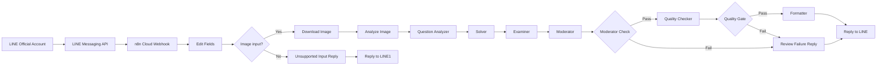

<p align="center">
  
</p>

# Math Intellect
## AI-Assisted Mathematics Learning Platform

**Project Lead:** Ngwe Htoon (Howard)  
**Role:** AI EdTech Product Developer | Mathematics Educator | Software R&D Professional  
**Current status:** Cloud-deployed functional MVP with live reviewer testing through LINE

Math Intellect is an AI-assisted mathematics learning platform that combines image-based question intake, mathematical reasoning, curriculum-aware processing, multi-stage quality review, workflow automation, and LINE-based delivery.

The current validated MVP is deployed on **n8n Cloud** and connected to the **Math Intellect LINE Official Account**. Users can submit mathematics-question images through LINE and receive structured text responses after the workflow completes its analysis, solving, assessment-review, moderation, quality-checking, and formatting stages.

> **Current deployment boundary:** This is a live functional MVP, not a production SaaS or institution-ready deployment. Persistent learner records, teacher dashboards, production monitoring, institutional administration, and broader SaaS infrastructure remain future work.

## Project Overview

Math Intellect was developed at the intersection of software engineering, international mathematics education, and AI-enabled workflow development.

The platform currently supports:

- LINE-based image submission
- n8n Cloud webhook orchestration
- OpenAI-assisted image and language processing
- Question analysis
- Step-by-step mathematical solution generation
- Examiner-inspired assessment guidance
- Moderator and quality-gate review
- JavaScript-based response formatting
- LINE reply delivery
- Safe user-facing responses for unsupported input and failed review gates

The current workflow focuses on Cambridge IGCSE Mathematics-style questions. Generated assessment guidance is **not** an official Cambridge mark scheme or certified grade.

## Current System Architecture



The **public GitHub workflow export is sanitized and inactive**. The live n8n Cloud workspace remains private because it contains operational configuration and connected credentials.

## Technology Stack

| Layer | Technology | Current role |
|---|---|---|
| User Interface | LINE Official Account | Image submission and response delivery |
| Messaging | LINE Messaging API | Inbound webhook events and outbound replies |
| Workflow Automation | n8n Cloud | Live end-to-end orchestration |
| AI Processing | OpenAI API | Image interpretation and language processing |
| Processing Logic | JavaScript | Structured data handling and response formatting |
| Public Technical Evidence | GitHub | Sanitized workflow, documentation, validation evidence |
| Future Persistent Services | Database / additional cloud services | Planned; not part of the current MVP |

## Current MVP Behavior

### Supported input

The reviewer-facing MVP expects a clear image of a mathematics question.

If the incoming LINE message is not a supported image input, the workflow routes:

```text
Edit Fields → If (false)
→ Unsupported Input Reply
→ Reply to LINE1
```

The user receives a request to submit a clear mathematics-question image.

### Main processing path

```text
Webhook
→ Edit Fields
→ If
→ Download Image
→ Analyze Image
→ Question Analyzer
→ Solver
→ Examiner
→ Moderator
→ Moderator Check
→ Quality Checker
→ Quality Gate
→ Formatter
→ Reply to LINE
```

### Review-failure path

If either the Moderator Check or Quality Gate fails, the workflow routes to:

```text
Moderator Check (false) ─┐
                         ├→ Review Failure Reply → Reply to LINE
Quality Gate (false) ────┘
```

This prevents the normal formatted answer from being sent when the workflow cannot verify the result through its current review gates.

## Diagram and Visual-Question Scope

The current cloud-deployed MVP can process mathematics questions that contain diagrams or graphical information and can generate the corresponding mathematical solution when the information is interpreted successfully.

A separate limitation applies when the **final answer itself must be rendered as a diagram, graph, construction, transformation, or other visual output**. The current stable reviewer-facing MVP does not yet generate that final rendered image. Instead, it can provide text-based drawing or construction instructions. Rendered visual-answer generation is under active development.

This distinction is important:

- **Diagram/graph in the input question:** supported within the current MVP, subject to interpretation quality.
- **Rendered diagram/graph required as the final output:** currently returned as text-based drawing instructions; image rendering remains under development.

## Live Reviewer Testing

### Math Intellect LINE Official Account

**LINE ID:** `@096jiiqu`

[Open the Math Intellect LINE Official Account](https://line.me/R/ti/p/@096jiiqu)


The LINE Official Account is the public user-facing testing interface. The private n8n Cloud editor is not provided as public access.

### Short Demonstration Video

**Math Intellect – Cloud-Deployed Functional MVP | Short Demonstration**

[Watch the short demonstration](https://youtu.be/98R2du9Jkoc)

The demonstration shows a mathematics question submitted through LINE, processed through the deployed n8n Cloud workflow, and returned as a structured response.

## Public Technical Evidence

### Sanitized n8n Workflow

[View the sanitized workflow export](workflow/math-intellect-workflow-sanitized.json)

The public JSON preserves the workflow structure and routing logic while removing credentials, live tokens, account-specific identifiers, and private deployment metadata.

See [workflow/README.md](workflow/README.md) for setup and security notes.

### Technical Documentation

- [Current Deployment Status](docs/deployment-status.md)
- [System Architecture](docs/system-architecture.md)
- [AI Workflow](docs/ai-workflow.md)
- [Quality Assurance](docs/quality-assurance.md)
- [Validation Methodology](docs/validation-methodology.md)
- [Development Roadmap](docs/roadmap.md)

## Prototype Validation Baseline

The documented prototype-validation baseline contains **51 Cambridge IGCSE Mathematics test cases**.

| Validation Metric | Reported Result |
|---|---:|
| Total Test Cases | 51 |
| Text Interpretation Accuracy | 100.00% (51/51) |
| Visual/Diagram Interpretation Accuracy | 4.17% (1/24 applicable) |
| Overall Question Interpretation Success | 54.90% (28/51) |
| Final Mathematical-Answer Accuracy | 95.65% (44/46 assessable) |
| Overall Sub-question Accuracy | 76.62% |
| Average Solution Completeness | 77.78% |
| Average Assessment Alignment | 92.66% |
| Successful End-to-End LINE Response Rate | 90.20% (46/51) |

**Important scope note:** These figures are a frozen historical validation baseline and must not be treated as a benchmark of every later workflow change. The current cloud deployment and newer failure-routing behavior postdate parts of that validation evidence. Selected diagram-containing questions have been repeatedly tested on the current workflow, but no new aggregate benchmark is claimed here.

### Detailed Validation Evidence

- [Prototype Validation Evidence Report (PDF)](validation/Math_Intellect_Prototype_Validation_Evidence_Record.pdf)
- [Prototype Validation Record (XLSX)](validation/Math_Intellect_Prototype_Validation_Record.xlsx)
- [Prototype Validation Evidence Slides (PPTX)](validation/Math_Intellect_Prototype_Validation_Evidence_Record.pptx)

## Current Limitations

The current MVP remains an early-stage technical product.

Known limitations include:

- Output quality depends on input-image clarity and correct interpretation.
- AI-generated mathematical responses can still contain errors.
- The frozen validation baseline identified significant historical weakness in visual/diagram interpretation.
- No new aggregate benchmark has yet replaced the frozen 51-case baseline.
- Final rendered visual answers are not yet generated; drawing instructions are returned as text where applicable.
- Persistent learner records are not implemented.
- Teacher dashboards and institutional administration are not implemented.
- Production-grade monitoring, access control, privacy operations, and service-level guarantees are not established.
- Educational impact, commercial traction, and institution-level outcomes have not been demonstrated.

## Development Roadmap

### 2026 — Functional MVP

**Implemented / current**

- LINE image submission
- n8n Cloud deployment
- OpenAI-assisted image and language processing
- Multi-stage reasoning and review workflow
- Safe unsupported-input reply
- Safe review-failure reply
- Structured LINE response
- Public GitHub documentation and sanitized workflow
- 51-case frozen technical-validation baseline
- Live reviewer testing

**Active development**

- Diagram/graph interpretation improvements
- Rendered visual-answer generation
- Wider regression testing
- Additional operational monitoring and reliability work

### 2027 — Teacher Productivity & SaaS Expansion

Planned work may include teacher dashboards, worksheet/question generation, persistent data services, analytics, PDF delivery, stronger monitoring, access controls, and a more complete SaaS architecture.

### 2028 — School / Learning-Centre Pilots

Planned, subject to reliability, privacy, educator review, and operational readiness.

### 2029+ — Regional Expansion

Potential additional curricula, multilingual support, learning analytics, and regional deployment.

## Long-Term Vision

Math Intellect aims to evolve into an AI-assisted STEM learning platform that complements teachers by extending access to structured mathematics support while preserving educator oversight.

## Project Report

The latest public technical report provides a comprehensive overview of Math Intellect, including its cloud-deployed MVP, system architecture, multi-stage AI processing, quality assurance framework, historical technical validation, current limitations, and future development roadmap.

**Latest Report**

- [Math Intellect Project Report V1.0 – Cloud Deployment Edition (PDF)](reports/Math_Intellect_Project_Report_Cloud_V1.0.pdf)

**Previous Report**

- [Math Intellect Project Report – Historical Prototype Edition (PDF)](reports/Math_Intellect_Project_Report_Public.pdf)

The September 2026 technical validation results represent the historical prototype baseline and are not presented as cloud deployment performance benchmarks.


> Some historical report sections describe the earlier local-development stage. The current repository Markdown documentation is the source of truth for the latest cloud-deployment status.

---

Math Intellect is an independent project and is not affiliated with or endorsed by Cambridge University Press & Assessment.
