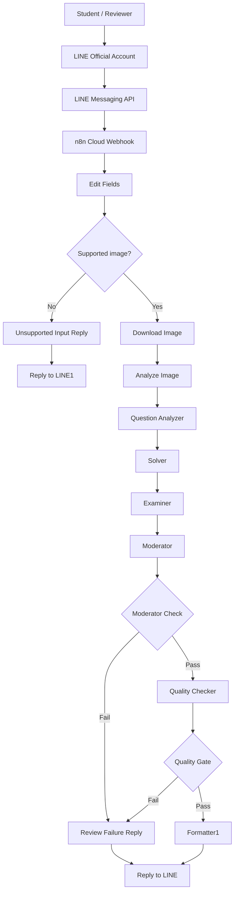

# System Architecture

## Math Intellect — Cloud-Deployed Functional MVP

**Project Lead:** Ngwe Htoon (Howard)  
**Document status:** Current reviewer-facing MVP architecture.

## Architecture Overview

## Deployment Boundary

### Implemented

- LINE Official Account
- LINE Messaging API
- n8n Cloud
- OpenAI API processing
- JavaScript formatting
- Safe unsupported-input reply
- Safe review-failure reply
- Live LINE response delivery

### Private operational boundary

The live n8n Cloud editor/workspace is private. It may contain operational configuration and connected credentials and is not the public reviewer interface.

### Public evidence boundary

GitHub contains:

- sanitized workflow JSON;
- architecture and workflow documentation;
- validation evidence;
- screenshots and demonstration links.

## Component Responsibilities

| Component | Role | Status |
|---|---|---|
| LINE Official Account | User-facing question submission and response | Implemented / live |
| LINE Messaging API | Inbound event and outbound reply transport | Implemented / live |
| n8n Cloud | Workflow orchestration and webhook hosting | Implemented / live |
| OpenAI API | Image and language processing | Implemented |
| Question Analyzer | Question classification and context | Implemented |
| Solver | Mathematical solution | Implemented |
| Examiner | Examiner-inspired assessment guidance | Implemented |
| Moderator | Consistency review | Implemented |
| Moderator Check | Pass/fail routing | Implemented |
| Quality Checker | Additional output review | Implemented |
| Quality Gate | Ready-for-student routing | Implemented |
| Formatter1 | Student-facing output assembly | Implemented |
| Unsupported Input Reply | Unsupported-input feedback | Implemented |
| Review Failure Reply | Safe review-failure feedback | Implemented |
| Persistent database | Learner/history storage | Planned |
| Teacher dashboard | Educator interface | Planned |
| Institution administration | School-level controls | Planned |
| Rendered visual-answer service | Generated final diagrams/graphs | Development only |

## Information Flow

1. User sends an image through LINE.
2. LINE sends the event to the n8n Cloud webhook.
3. The workflow validates the message type.
4. Unsupported input is returned through `Unsupported Input Reply`.
5. Supported image input is retrieved and interpreted.
6. The mathematical task passes through analysis, solving, assessment review, moderation, and quality checking.
7. Failed review gates route to `Review Failure Reply`.
8. Approved output is formatted and returned through LINE.

## Diagram / Visual Boundary

Input questions may contain diagrams or graphical information.

The current limitation is final rendered visual output: if the answer itself must be drawn, the stable cloud MVP provides text-based drawing instructions. Generated final visual rendering is under active development.

## Security Boundary

Public assets must exclude:

- API keys
- LINE tokens / secrets
- n8n credential IDs
- instance IDs
- raw reply tokens
- private user identifiers
- private student content

The public workflow export is inactive and sanitized.

## Future Architecture

Future work may add:

- persistent data services;
- stronger monitoring and logging;
- access control;
- teacher dashboards;
- PDF/report delivery;
- institutional administration;
- analytics;
- rendered visual-answer services;
- production SaaS safeguards.

The current cloud MVP should not be described as institution-ready production SaaS.
